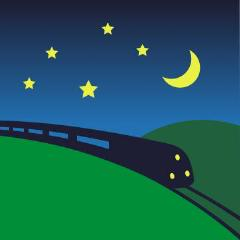
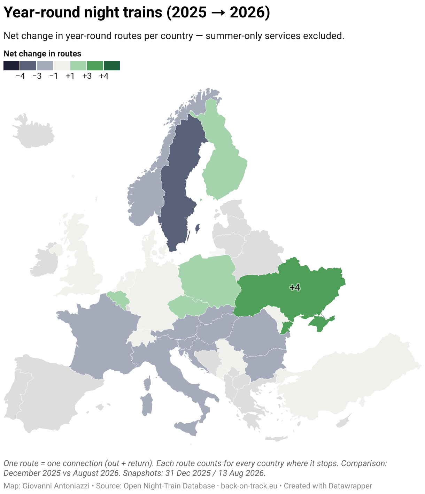
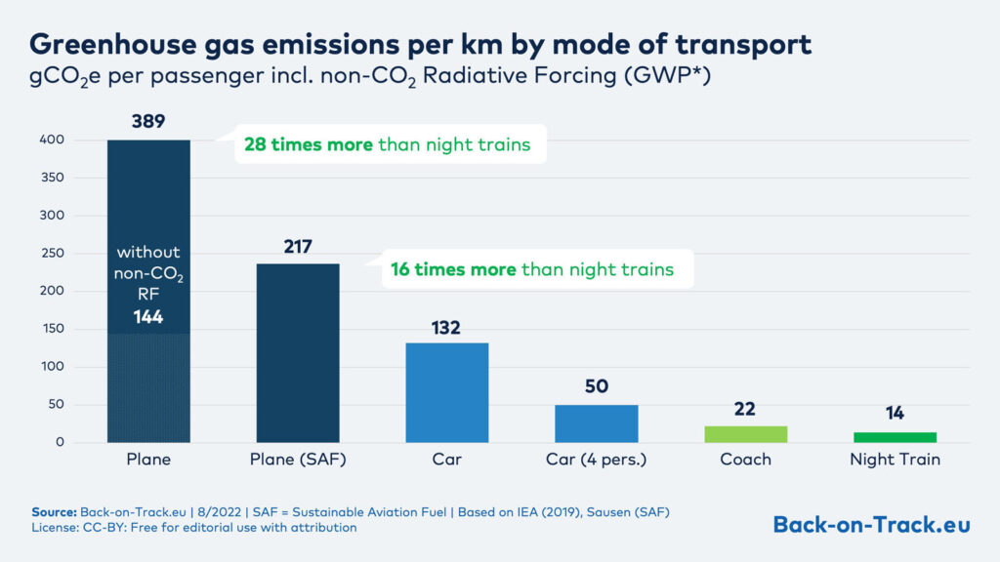
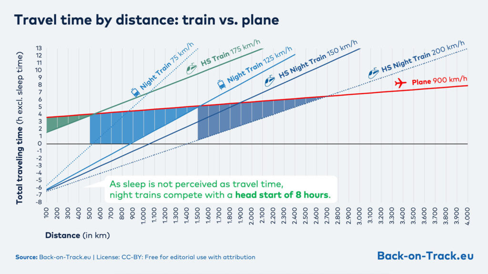
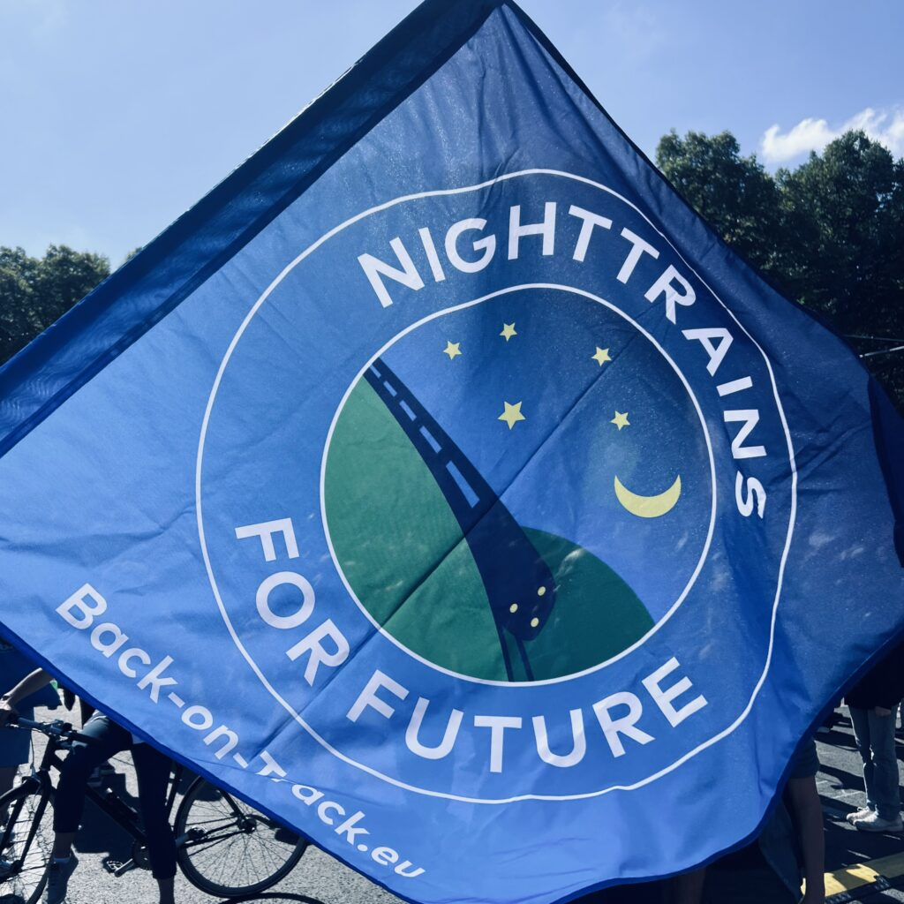

<p align="center">
  <picture>
    <source media="(prefers-color-scheme: dark)" srcset="docs/img/bot-logo-inverted.png">
    
  </picture>
</p>

<h1 align="center">Open Night Train Database</h1>

<p align="center">
  <b>All the night trains in Europe, in one open database.</b><br>
  Kept up to date by <a href="https://back-on-track.eu/about/">Back-on-Track</a> volunteers. Free to use, share and build on.
</p>

<p align="center">
  <a href="LICENSE-DATA"></a>
  <a href="LICENSE"></a>
  <a href=".github/workflows/daily_update_from_gsheet.yml"></a>
  <a href="CONTRIBUTING.md"></a>
  <a href="https://doi.org/10.5281/zenodo.23426817"></a>
</p>

<p align="center">
  <a href="https://back-on-track.eu/night-train-map/"><b>🗺️ Night train map</b></a> ·
  <a href="data/latest/"><b>📦 Download the data</b></a> ·
  <a href="../../issues/new/choose"><b>🐛 Report a mistake</b></a> ·
  <a href="CONTRIBUTING.md"><b>🤝 Help us</b></a>
</p>

---

## 🚆 At a glance

| Night train routes | Operators | Countries | Cities on the map |
|:---:|:---:|:---:|:---:|
| **~200** | **~30** | **26** | **~700** |

<sub>October 2026. The numbers change as trains start, stop or change; <code>data/latest/</code> always has the current state.</sub>

The database covers night trains from Inverness to Istanbul and from Kyiv to Palermo. It powers the [night train map](https://back-on-track.eu/night-train-map/) on our website, and anyone can use it: travel apps, researchers, journalists, cities, or you.

[Back-on-Track](https://back-on-track.eu/about/) is a European network of people and organisations who campaign for more and better night trains. Read [what we ask for](https://back-on-track.eu/general-position-paper/), [how we work](https://back-on-track.eu/how-we-work/), or find a [group near you](https://back-on-track.eu/groups/).

## 🗺️ How the network changed in 2026

<p align="center">
  <a href="https://datawrapper.dwcdn.net/qMMel/"></a>
</p>
<p align="center"><sub>Click the map for the interactive version. Also: <a href="https://datawrapper.dwcdn.net/pLzsi/">all trains, including seasonal</a> · <a href="https://datawrapper.dwcdn.net/ChBxh/">seasonal trains only</a>. Map: Giovanni Antoniazzi, data: Open Night Train Database.</sub></p>

## 🌙 Why night trains?

A night train emits a fraction of a plane per kilometre, and because you sleep on board, it starts the race with a head start of about eight hours.

<p align="center">
  
  
</p>
<p align="center"><sub>Graphics: <a href="https://back-on-track.eu/faqs-about-night-trains-and-european-railway-policy/">Back-on-Track.eu</a>, CC-BY. More answers in our <a href="https://back-on-track.eu/faqs-about-night-trains-and-european-railway-policy/">FAQ</a>.</sub></p>

## 🧭 Find your way

| I want to… | Go here |
|---|---|
| See the night trains on a map | [Night train map](https://back-on-track.eu/night-train-map/) |
| Read about the database | [Open Night Train Database](https://back-on-track.eu/open-night-train-database/) and the [editors' guide](https://back-on-track.eu/how-to-open-night-train-database-ontd/) |
| Download the data | [`data/latest/`](data/latest/) (JSON files) |
| Use the data in a website or app | `https://back-on-track-eu.github.io/night-train-data/data/latest/<file>.json` (stable address, open to any website) |
| Browse the master spreadsheet | [Google Sheet](https://docs.google.com/spreadsheets/d/15zsK-lBuibUtZ1s2FxVHvAmSu-pEuE0NDT6CAMYL2TY/edit?usp=sharing) (read-only) |
| Report a mistake or a missing train | [Open an issue](../../issues/new/choose) |
| Help as a volunteer or developer | [CONTRIBUTING.md](CONTRIBUTING.md) and our [open tasks](https://back-on-track.eu/open-tasks/) |
| Read what Back-on-Track asks for | Our [general position paper](https://back-on-track.eu/general-position-paper/) |
| Design the night train network of 2032 | [Target Network tool](https://targetnetwork.back-on-track.eu/) ([about the project](https://back-on-track.eu/project-target-network-2032/)) |
| Book a night train | [How to book a night train](https://back-on-track.eu/how-to-book-a-night-train/) |
| Cite the data | [How to cite](#-how-to-cite) |

## 📦 What's in the data

The structure is inspired by [GTFS](https://gtfs.org/), the common format for public transport timetables. Every file in [`data/latest/`](data/latest/) is a JSON object keyed by its ID.

| File | What it holds |
|---|---|
| `agencies.json` | The train operators |
| `routes.json` | Night train routes, one per line (for example Vienna to Hamburg) |
| `trips.json` | The trips on each route, usually one per direction, with times, travel classes and on-board facilities |
| `trip_stop.json` | The stops of each trip, with arrival and departure times |
| `stops.json` | Stations. A large reference list, not only the stations night trains call at |
| `calendar.json`, `calendar_dates.json` | When the trains run, and the exceptions |
| `classes.json` | Travel classes (seat, couchette, sleeper) |
| `translations.json` | Names of operators and stations in other languages |
| `view_ontd_*.json` | Ready-made views for the map and the lists on our website (`map`, `list`, `details`, `cities`) |

## 🔄 How the data gets here

```
 Volunteers edit the Google Sheet
            │
            ▼
 Apps Script (scripts/code.gs) serves each sheet as JSON
            │
            ▼
 GitHub Action runs scripts/get_snapshot.py at 02:00 and 14:00 UTC
            │
            ▼
 data/latest/  →  the night train map and everyone else
```

> [!IMPORTANT]
> The files in `data/` are overwritten twice a day, so please don't edit them by hand. If something is wrong, [open an issue](../../issues/new/choose) and we'll fix it in the sheet.

Every file is also served at a stable address, for example [`https://back-on-track-eu.github.io/night-train-data/data/latest/routes.json`](https://back-on-track-eu.github.io/night-train-data/data/latest/routes.json). Any website or app can load it directly.

Need a fresh copy right away? Run `python3 scripts/get_snapshot.py`, or download a single table from the hosted script:
`https://script.google.com/macros/s/AKfycbwY9zNQFq0urCHsTstWRKxLe0SstWrwyY04tSuDIVb_yRCtTs_HDlRARS-5fqltgEZr/exec?table=<name>`, where `<name>` is one of the file names above without `.json`.

## ⚖️ Licence

The night train data in this repository (everything under `data/`, and the same database served through the sheet and the API) is the **Open Night Train Database** by Back-on-Track Europe. It is licensed under the **[Open Database License (ODbL) 1.0](https://opendatacommons.org/licenses/odbl/1-0/)**, see [`LICENSE-DATA`](LICENSE-DATA). The individual contents of the database are licensed under the **[Database Contents License (DbCL) 1.0](https://opendatacommons.org/licenses/dbcl/1-0/)**, see [`LICENSE-DATA-CONTENTS`](LICENSE-DATA-CONTENTS). This is the same set-up OpenStreetMap uses; part of our station coordinates come from OpenStreetMap.

In practice: you can use the data, also commercially, as long as you credit **Back-on-Track Europe** with a link to [back-on-track.eu](https://back-on-track.eu/), and if you share an adapted version of the database, you share it under the ODbL as well.

Suggested attribution: `Night train data © Back-on-Track Europe, Open Night Train Database (ODbL 1.0), back-on-track.eu`

The code in this repository (`scripts/` and the workflow files) is licensed under the **GNU General Public License v3.0**, see [`LICENSE`](LICENSE).

The night train **map artwork** on back-on-track.eu is not part of this repository and stays under **CC BY-NC-ND 4.0**, credit "Juri Maier / Back-on-Track.eu".

Decided by the Back-on-Track Europe board, 2026.

## 📝 How to cite

Every release of this repository is archived on [Zenodo](https://zenodo.org/) with a DOI, so the data can be cited in reports, articles and research.

> Back-on-Track Europe. *Open Night Train Database (ONTD)*. Zenodo. [https://doi.org/10.5281/zenodo.23426817](https://doi.org/10.5281/zenodo.23426817)

This DOI always points to the latest edition. Each edition also has its own DOI, listed on Zenodo (2026.10: [10.5281/zenodo.23426818](https://doi.org/10.5281/zenodo.23426818)). GitHub's **"Cite this repository"** button in the sidebar gives the reference in other formats.

## 🤝 Who looks after this

<p align="center">
  
</p>

The database is coordinated by Giovanni Antoniazzi ([@giovanto](https://github.com/giovanto)), vicechair of Back-on-Track, together with many volunteers. [Join them](CONTRIBUTING.md)!

Questions about the data: [open an issue](../../issues/new/choose). Anything else: [contact us](https://back-on-track.eu/contact/). Want to support our work? [Become a member](https://back-on-track.eu/become-a-member/) or [donate](https://back-on-track.eu/donate/).
